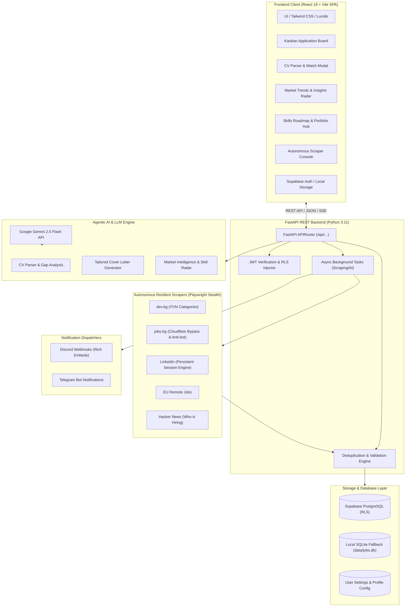

# 🤖 Job-Finder v2: Autonomous Agentic Job Intelligence Platform

[](https://fastapi.tiangolo.com)
[](https://react.dev)
[](https://www.typescriptlang.org)
[](https://tailwindcss.com)
[](https://supabase.com)
[](https://ai.google.dev)
[](https://playwright.dev)
[](https://www.docker.com)
[](https://www.archevyn.dev/projects/job-finder)

> **Flagship Portfolio Project by Petur Ganchev**  
> Engineered for **Agentic AI Systems, LLM Orchestration & Full-Stack AI Engineering** roles.  
> Live Showcase: [www.archevyn.dev/projects/job-finder](https://www.archevyn.dev/projects/job-finder)

---

## 🧭 Executive Summary & Overview

**Job-Finder v2** is a production-grade autonomous agentic platform designed to discover, aggregate, filter, score, and analyze job opportunities across **Agentic AI, Machine Learning, Data Science, and Python Engineering** sectors (Sofia, Bulgaria & Remote Worldwide).

Originally prototyped as a monolithic Streamlit application (v1), the project underwent a complete architectural re-engineering into a modern, distributed, multi-tenant system (v2):
- **Modern SPA Client:** Built with React 18, Vite, TypeScript, Tailwind CSS, and Lucide Icons.
- **High-Performance REST Backend:** Powered by FastAPI, Pydantic v2 validation, and async background workers.
- **Cloud Database with Row-Level Security:** Hosted on Supabase (PostgreSQL) with automatic local SQLite fallback.
- **Agentic Pipeline & Scraping Engine:** Playwright Stealth browser automation paired with Google Gemini 2.5 Flash for deep semantic skill-matching and market intelligence.

```
┌────────────────────────────────────────────────────────────────────────────────────────┐
│                                   JOB-FINDER v2 ECOSYSTEM                              │
├────────────────────────────────┬───────────────────────┬───────────────────────────────┤
│        Frontend (React SPA)    │    API (FastAPI REST) │   Intelligence & Data Engine  │
│  • Kanban Application Board    │  • Async Endpoints    │ • Google Gemini 2.5 Flash     │
│  • CV Skill Matcher & Parser   │  • Job Deduplication  │ • Playwright Stealth Crawlers │
│  • Market Intelligence Radar   │  • Real-time SSE Logs │ • Supabase Cloud PostgreSQL   │
│  • Skill Roadmap & Portfolio   │  • Pydantic Schemas   │ • Multi-Channel Dispatchers   │
└────────────────────────────────┴───────────────────────┴───────────────────────────────┘
```

---

## 🏛️ System Architecture



---

## 🌟 Key Features

### 1. 📊 Interactive Kanban Job Board
- Comprehensive lifecycle tracking for every position: **New** ➔ **Applied** ➔ **Interview** ➔ **Offer** ➔ **Archived**.
- Instant filtering by location (**Remote / On-site / Hybrid**), portal source, minimum AI Match Score, and keyword search.
- Mobile-first responsive UX with fixed bottom navigation docked for on-the-go review.

### 2. 🧠 AI Scoring, CV Parser & Skill Gap Analysis (Google Gemini 2.5 Flash)
- **Automated CV Parser:** Upload PDF/Word resumes; automatically extracts verified skills, technical stacks, and years of experience.
- **Semantic Match Scoring (0–100%):** Calculates custom compatibility between candidate profile and real-time job specifications.
- **Skill Gap Detection:** Identifies missing competencies (e.g., *CrewAI, LangGraph, vLLM, Vector Databases, RAG architectures*).
- **Custom Cover Letter Generator:** Synthesizes highly customized, persuasive cover letters in English or Bulgarian within seconds.

### 3. 🕷️ Autonomous Multi-Portal Scraper Suite
- **dev.bg** – Direct extraction of IT/AI positions with custom tech tag filtering.
- **jobs.bg** – Resilient scraping with dynamic delays and anti-bot mitigation.
- **LinkedIn** – Headless browser automation using Playwright Stealth and persistent session profiles to avoid authwalls and CAPTCHAs.
- **EU Remote Jobs & Hacker News** – Aggregates verified international remote opportunities.
- **Built-in Deduplication:** Normalizes company names, titles, and query params to prevent duplicate listings.

### 4. 📈 Market Intelligence & Skill Roadmap Radar
- Real-time visualization of high-demand AI skills across the Sofia and European remote markets.
- Portal distribution metrics and role classification breakdown.
- Integrated **Skill Roadmap & Portfolio Hub** mapping personal milestones and real-world project completions.

### 5. 🛡️ Enterprise Security & Supabase Row-Level Security (RLS)
- Data isolation guaranteed by PostgreSQL Row-Level Security: users access only their own saved jobs, custom keywords, and personal analysis.
- Seamless fallback to local SQLite for offline demonstrations without external infrastructure requirements.

---

## ⚡ Quickstart Guide

### Option 1: Docker Compose (Production Setup)

1. Clone the repository and navigate to the directory:
   ```bash
   git clone https://github.com/PeturGanchev/Job-Finder.git
   cd Job-Finder
   ```
2. Copy environment template and populate your credentials:
   ```bash
   cp .env.example .env
   ```
3. Launch the full containerized stack (FastAPI + React NGINX):
   ```bash
   docker-compose up --build -d
   ```
4. Access the applications:
   - **Frontend UI:** [http://localhost:3000](http://localhost:3000)
   - **Interactive API Docs (Swagger):** [http://localhost:8000/docs](http://localhost:8000/docs)

---

### Option 2: Local Development Setup

#### 1. Backend (Python 3.11 + FastAPI)
```bash
# Create and activate virtual environment
python -m venv .venv
.\.venv\Scripts\activate      # Windows
# source .venv/bin/activate   # Linux/macOS

# Install dependencies and Playwright Chromium binaries
pip install -r requirements.txt
playwright install --with-deps chromium

# Start the FastAPI REST backend
python run.py --api
```
*API server runs at `http://127.0.0.1:8000` (Swagger UI at `/docs`).*

#### 2. Frontend (React 18 + Vite + TypeScript)
```bash
cd frontend
npm install
npm run dev
```
*Frontend dev server runs at `http://localhost:5173`.*

---

### Option 3: Legacy Streamlit Dashboard (v1 Prototype)
To inspect the historical prototype and compare with v2:
```bash
python run.py --dashboard
# or
python run.py --legacy
```
*(See the detailed evolution report in [`legacy/README.md`](legacy/README.md)).*

---

## 💻 CLI Automation & Cron Suite (`run.py`)

Job-Finder provides a powerful command-line interface for headless automation and scheduled cron jobs:

```bash
# Launch the FastAPI REST backend (v2)
python run.py --api

# Trigger autonomous search, Gemini analysis, and notification dispatch
python run.py --search

# Scrape specific sources in headless mode with job limit
python run.py --search --sources dev.bg jobs.bg --headless --max-jobs 20

# Generate console market insights report for Sofia AI market
python run.py --insights

# Inspect database metrics and listing counts
python run.py --stats

# Verify live status of saved listings and prune expired ones
python run.py --cleanup

# Interactive browser login for LinkedIn persistent session
python run.py --login
```

---

## 🗂️ Project Structure

```text
Job-Finder/
├── config/                     # YAML configuration profiles & filter lists
│   ├── filters.yaml            # Search keywords and title blacklists
│   ├── profile.yaml            # Candidate profile, target roles, stack
│   └── settings.yaml           # Browser parameters, timeouts, scraping limits
├── data/                       # Local storage (SQLite fallback database)
├── frontend/                   # Modern SPA React + Vite client
│   ├── src/
│   │   ├── components/         # UI components, Kanban board, modal dialogs
│   │   │   ├── auth/           # Supabase Auth modal & session handling
│   │   │   ├── jobs/           # Kanban columns, job cards, detail modals
│   │   │   ├── intelligence/   # Market insights and AI report visualizers
│   │   │   └── navigation/     # Desktop navbar and docked mobile navigation
│   │   ├── context/            # Authentication context provider
│   │   ├── lib/                # API client and Supabase SDK integration
│   │   ├── types.ts            # Strict TypeScript domain interfaces
│   │   └── App.tsx             # Root Application State Container
│   ├── Dockerfile              # Multi-stage NGINX build container
│   ├── nginx.conf              # SPA route rewrites & reverse proxy
│   └── vercel.json             # Vercel deployment configuration
├── legacy/                     # Archived v1 Streamlit prototype
│   ├── streamlit_app.py        # Original monolithic script
│   └── README.md               # Architectural retrospective (v1 -> v2)
├── reports/                    # Generated Markdown market intelligence reports
├── src/                        # Backend core implementation
│   ├── api/                    # Modular FastAPI routers
│   │   ├── main.py             # App factory, CORS, and lifespan handlers
│   │   ├── jobs.py             # CRUD endpoints, Kanban status transitions
│   │   ├── scrapers.py         # SSE streaming scraper trigger endpoints
│   │   ├── intelligence.py     # Gemini AI evaluation, CV parsing, gap analysis
│   │   └── settings.py         # User keyword and preference synchronization
│   ├── database/               # Database abstraction layer
│   │   ├── models.py           # Pydantic domain models
│   │   ├── repository.py       # SQLite repository implementation
│   │   └── supabase_repo.py    # Supabase PostgreSQL repository with RLS
│   ├── intelligence/           # Gemini analyzer and market insight engines
│   ├── notifiers/              # Discord Webhook & Telegram bot dispatchers
│   ├── scrapers/               # Playwright Stealth web scrapers
│   └── worker/                 # Cloudflare Worker edge reverse proxy
├── tests/                      # Automated test suite
│   └── test_api_endpoints.py   # Comprehensive FastAPI endpoint test coverage
├── Dockerfile                  # Production container (Python 3.11 + Playwright)
├── docker-compose.yml          # Multi-container full-stack composition
├── requirements.txt            # Python dependencies
├── run.py                      # Master CLI coordinator
├── wrangler.jsonc              # Cloudflare Worker & Static Assets config
└── README.md                   # Flagship documentation
```

---

## 🔄 Architectural Retrospective (v1 Streamlit ➔ v2 FastAPI + React)

| Dimension | v1 Prototype | v2 Production Platform |
| :--- | :--- | :--- |
| **User Interface** | Streamlit (Monolithic Python with full-page reruns) | React 18 + Vite SPA, Tailwind CSS, Lucide Icons, Client-Side State |
| **Backend Architecture**| Direct in-process Python calls from UI script | Modular FastAPI REST API with Pydantic v2 schemas and SSE streaming |
| **Persistence** | Local SQLite single-file (`data/jobs.db`) | Supabase PostgreSQL with Row-Level Security (RLS) + Local SQLite fallback |
| **Session Model** | Local folder cookies for a single user | Supabase Auth (JWT) with persistent sessions and multi-tenant isolation |
| **Mobile Experience** | Constrained responsive rendering | Fully optimized mobile layout with docked bottom navigation |
| **Scraping Model** | Blocking UI execution thread | Async background execution with live streaming SSE terminal logs |
| **Deployment** | Local Python execution only | Docker Compose, Cloudflare Worker Edge Proxy, and Vercel/Cloud ready |

---

## 🧪 Automated Testing & Verification

The backend is backed by an automated test suite verifying all REST endpoints:

```bash
# Execute API verification suite
.\.venv\Scripts\python.exe tests/test_api_endpoints.py
```

Test coverage includes:
- ✅ System health check (`GET /api/health`)
- ✅ Job CRUD operations and Kanban status lifecycle updates
- ✅ Real-time scraper event streaming via Server-Sent Events (SSE)
- ✅ Market analytics calculation and portal distribution metrics
- ✅ Authenticated user settings and custom keyword synchronization

---

## 👤 Author & Contact

**Petur Ganchev**  
*Senior Full-Stack & Agentic AI Engineer*  
- 🌐 Portfolio: [www.archevyn.dev](https://www.archevyn.dev)  
- 💼 LinkedIn: [linkedin.com/in/peturganchev](https://www.linkedin.com/in/peturganchev)  
- 🐙 GitHub: [github.com/PeturGanchev](https://www.github.com/PeturGanchev)  

---

## 📄 License

This project is open-source under the [MIT License](LICENSE).
