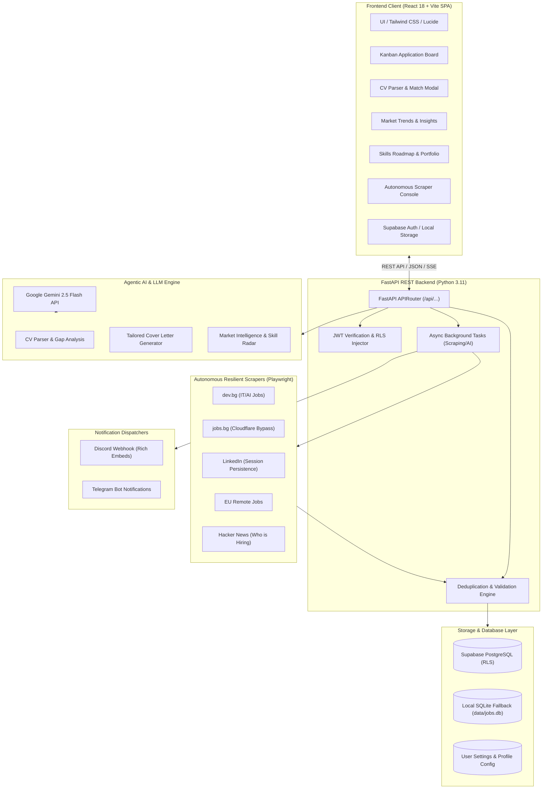

# 🤖 Job-Finder v2: Autonomous Agentic Job Intelligence Platform

[](https://fastapi.tiangolo.com)
[](https://react.dev)
[](https://www.typescriptlang.org)
[](https://tailwindcss.com)
[](https://supabase.com)
[](https://ai.google.dev)
[](https://playwright.dev)
[](https://www.docker.com)
[](https://www.archevyn.dev/projects/job-finder)

> **Флагмански Portfolio Проект от Петър Ганчев (Petur Ganchev)**  
> Проектиран за роли в сферата на **Agentic AI Systems, LLM Orchestration & Full-Stack AI Engineering**.  
> Онлайн визитка: [www.archevyn.dev/projects/job-finder](https://www.archevyn.dev/projects/job-finder)

---

## 🧭 Преглед на Проекта (Overview)

**Job-Finder v2** е пълномащабна, автономна агентна платформа за търсене, агрегиране, интелигентно филтриране и пазарен анализ на обяви за работа в областта на **Agentic AI, Machine Learning, Data Science и Python Engineering** (София, България & Remote Worldwide).

Системата еволюира от първоначален монолитен Streamlit прототип (v1) до съвременна модулна разпределена архитектура (v2):
- **Модерен SPA фронтенд (React 18 + Vite + TypeScript + Tailwind CSS + Lucide Icons)**
- **Високопроизводителен REST API бекенд (FastAPI + Pydantic v2 + Uvicorn)**
- **Cloud база данни с Row-Level Security (Supabase PostgreSQL)** и локален SQLite fallback
- **Мулти-агентен конвейер за скрапване и анализ (Playwright Stealth + Gemini 2.5 Flash)**

```
┌────────────────────────────────────────────────────────────────────────────────────────┐
│                                   JOB-FINDER v2 ECOSYSTEM                              │
├────────────────────────────────┬───────────────────────┬───────────────────────────────┤
│        Frontend (React SPA)    │    API (FastAPI REST) │   Intelligence & Data Engine  │
│  • Kanban Board & Statuses     │  • Async Endpoints    │ • Google Gemini 2.5 Flash     │
│  • CV Skill Matcher & Parser   │  • Job Deduplication  │ • Playwright Stealth Crawlers │
│  • Market Trends Analytics     │  • Real-time SSE Logs │ • Supabase Cloud PostgreSQL   │
│  • Skill Roadmap & Portfolio   │  • Pydantic Schemas   │ • Multi-Channel Notifiers     │
└────────────────────────────────┴───────────────────────┴───────────────────────────────┘
```

---

## 🏛️ Архитектура на Системата (System Architecture)



---

## 🌟 Ключови Възможности (Key Features)

### 1. 📊 Интерактивен Kanban Борд за Кандидатстване
- Управление на жизнения цикъл на всяка обява: **Нови (New)** ➔ **Кандидатствал (Applied)** ➔ **Интервю (Interview)** ➔ **Оферта (Offer)** ➔ **Архив (Archived)**.
- Бързи филтри по локация (Remote / On-site / Hybrid), източник, минимален AI Match Score, търсене по ключова дума.
- Мобилно-оптимизиран интерфейс с фиксирана долна навигация за тестване в движение.

### 2. 🧠 AI Оценка, CV Парсер и Gap Анализ (Google Gemini 2.5 Flash)
- **Автоматичен CV Парсер:** Качване на PDF/Word автобиография, извличане на ключови умения и опит.
- **Индивидуален Match Score (0–100%):** Сравняване на изискванията на обявата с уменията на потребителя.
- **Gap анализ на уменията:** Открива липсващите технологии (напр. *CrewAI, LangGraph, vLLM, Vector DBs*).
- **Генератор на Мотивационни Писма:** Автоматично генерира персонализирано, професионално придружително писмо на български или английски език.

### 3. 🕷️ Автономни Мулти-Портални Скрапъри
- **dev.bg** – Директен парсинг на IT обяви с фокус върху AI/ML и Python.
- **jobs.bg** – Устойчиво извличане с адаптивни забавяния и сесии.
- **LinkedIn** – Браузърна сесия с Playwright Stealth за предотвратяване на блокировки и капчи.
- **EU Remote Jobs & Hacker News** – Автоматично агрегиране на международни позиции за дистанционна работа.
- **Вградена Дедупликация:** Разпознаване на дублирани позиции по нормализирано заглавие, компания и URL.

### 4. 📈 Пазарен Анализ и Интелигентен Skill Roadmap
- Визуализация на най-търсените умения в София и Remote сектора.
- Разпределение на обявите по портали и типове роли.
- Интегриран персонален **Skill Roadmap & Portfolio Hub** за визуализация на напредъка и реализираните проекти.

### 5. 🛡️ Многопотребителска Сигурност & Supabase RLS
- Пълна изолация на данните чрез **Supabase Row-Level Security (RLS)**: всеки потребител вижда и управлява единствено своите обяви, настройки и профил.
- Автоматичен Fallback към локална SQLite база за офлайн работа или демонстрация без външни зависимости.

---

## ⚡ Бърз Старт (Quickstart)

### Вариант 1: С Docker Compose (Препоръчително за Продукция)

1. Клонирайте хранилището и влезте в директорията:
   ```bash
   git clone https://github.com/PeturGanchev/Job-Finder.git
   cd Job-Finder
   ```
2. Копирайте конфигурационния файл и добавете вашите ключове:
   ```bash
   cp .env.example .env
   ```
3. Стартирайте пълен контейнеризиран стек (FastAPI + React NGINX):
   ```bash
   docker-compose up --build -d
   ```
4. Отворете браузъра:
   - **Frontend:** [http://localhost:3000](http://localhost:3000)
   - **FastAPI Docs (Swagger):** [http://localhost:8000/docs](http://localhost:8000/docs)

---

### Вариант 2: Локално Разработване (Local Development)

#### 1. Бекенд (Python 3.11 + FastAPI)
```bash
# Създаване и активиране на виртуална среда
python -m venv .venv
.\.venv\Scripts\activate      # За Windows
# source .venv/bin/activate   # За Linux/macOS

# Инсталиране на зависимостите и браузърите
pip install -r requirements.txt
playwright install --with-deps chromium

# Стартиране на FastAPI бекенда
python run.py --api
```
*API сървърът работи на `http://127.0.0.1:8000` (Swagger UI на `/docs`).*

#### 2. Фронтенд (React 18 + Vite)
```bash
cd frontend
npm install
npm run dev
```
*Интерфейсът е достъпен на `http://localhost:5173`.*

---

### Вариант 3: Наследен Streamlit Дашборд (v1 Legacy)
За обратна съвместимост и сравнение с v1 прототипа:
```bash
python run.py --dashboard
# или
python run.py --legacy
```
*(Вижте подробния ретроспективен анализ в [`legacy/README.md`](legacy/README.md)).*

---

## 💻 CLI Команди за Автономен Режим (`run.py`)

Job-Finder предоставя мощен CLI интерфейс за планирани cron задачи или работа в терминал:

```bash
# Стартиране на API сървъра (v2)
python run.py --api

# Автономно търсене, AI анализ и изпращане на известия
python run.py --search

# Търсене само в специфични източници в напълно скрит режим
python run.py --search --sources dev.bg jobs.bg --headless --max-jobs 20

# Генериране на консолен пазарен AI доклад за уменията в София
python run.py --insights

# Показване на статистика за базата данни
python run.py --stats

# Проверка за активност на запазените обяви и почистване на изтекли
python run.py --cleanup

# Еднократен интерактивен вход за LinkedIn сесия
python run.py --login
```

---

## 🗂️ Структура на Проекта (Project Structure)

```text
Job-Finder/
├── config/                     # YAML конфигурационни профили и филтри
│   ├── filters.yaml            # Ключови думи и черен списък за търсене
│   ├── profile.yaml            # Личен профил на кандидата и цели
│   └── settings.yaml           # Браузърни параметри и тайминги
├── data/                       # Локални данни (SQLite DB fallback, кеш)
├── frontend/                   # Модерен SPA React + Vite фронтенд
│   ├── src/
│   │   ├── components/         # UI компоненти, Kanban борд, модали, диаграми
│   │   │   ├── auth/           # Supabase Auth диалог и сесии
│   │   │   ├── jobs/           # Kanban колони, детайлни карти за обяви
│   │   │   ├── intelligence/   # Пазарен анализ и AI генератори
│   │   │   └── navigation/     # Десктоп и мобилна лента за навигация
│   │   ├── services/           # API клиент, Supabase клиент
│   │   ├── types/              # Строги TypeScript интерфейси за обяви и филтри
│   │   └── App.tsx             # Главен State Container
│   ├── Dockerfile              # Multi-stage NGINX контейнер
│   ├── nginx.conf              # SPA пренасочвания и API proxy
│   └── vercel.json             # Конфигурация за Vercel хостинг
├── legacy/                     # Наследен v1 Streamlit прототип
│   ├── streamlit_app.py        # Оригиналното v1 монолитно приложение
│   └── README.md               # Архитектурна ретроспектива v1 -> v2
├── reports/                    # Генерирани пазарни доклади в Markdown
├── src/                        # Сърцевина на бекенда
│   ├── api/                    # Модулни FastAPI рутери
│   │   ├── main.py             # FastAPI App инстанция, CORS и lifespan
│   │   ├── jobs.py             # CRUD за обяви, статуси и дедупликация
│   │   ├── scrapers.py         # SSE Streaming ендпойнти за скрапърите
│   │   ├── intelligence.py     # Gemini AI интеграция, CV парсер, gap анализ
│   │   └── settings.py         # Синхронизация на потребителски филтри
│   ├── database/               # База данни абстракция
│   │   ├── models.py           # Pydantic & SQLAlchemy модели
│   │   ├── repository.py       # Локален SQLite репозиторий
│   │   └── supabase_repo.py    # Supabase PostgreSQL репозиторий с RLS
│   ├── intelligence/           # Gemini анализатори и пазарен AI генератор
│   ├── notifiers/              # Discord Webhook и Telegram ботове
│   └── scrapers/               # Playwright Stealth модули за различните сайтове
├── tests/                      # Автоматизирани тестове
│   └── test_api_endpoints.py   # Пълно тестово покритие на FastAPI рутерите
├── Dockerfile                  # Продукционен Dockerfile за Python + Playwright
├── docker-compose.yml          # Пълна мулти-контейнерна конфигурация
├── requirements.txt            # Python зависимости
├── run.py                      # Главен CLI мениджър
└── README.md                   # Главна документация на проекта
```

---

## 🔄 Архитектурна Ретроспектива (v1 Streamlit ➔ v2 FastAPI + React)

| Характеристика | v1 (Прототип) | v2 (Продукционна Платформа) |
| :--- | :--- | :--- |
| **Интерфейс** | Streamlit (Python монолит с цялостно пререндериране) | React 18 + Vite SPA, Tailwind CSS, Lucide Icons, Client-Side Routing |
| **Бекенд Архитектура** | Директни Python извиквания от UI скрипта | Модулен FastAPI REST API с Pydantic валидация и SSE стрийминг |
| **База Данни** | Локален SQLite файл (`data/jobs.db`) | Supabase PostgreSQL с Row-Level Security (RLS) + SQLite Fallback |
| **Управление на Сесии** | Локална папка с бисквитки за един потребител | Supabase Auth (JWT) с постоянни сесии и мулти-тенант изолация |
| **Мобилност** | Ограничено форматиране на малки екрани | Напълно отзивчив дизайн с фиксирано долно меню за мобилни устройства |
| **Скрапване** | Блокиращо изпълнение в нишката на интерфейса | Асинхронни фонови задачи с конзолен стрийминг в реално време |
| **Деплоймънт** | Локално стартиране | Docker, Docker Compose, Vercel SPA + Cloud API |

---

## 🧪 Тестове и Валидация (Testing)

Проектът разполага с цялостен набор от тестове за валидация на бекенда:

```bash
# Изпълнение на API тестовете с виртуалната среда
.\.venv\Scripts\python.exe tests/test_api_endpoints.py
```

Тестовият пакет проверява:
- ✅ Здравен статус на системата (`GET /api/health`)
- ✅ CRUD операции за обяви и обновяване на статуси в Kanban борда
- ✅ Стрийминг на скрапър събития през Server-Sent Events (SSE)
- ✅ Изчисляване на пазарни статистики и разпределение по портали
- ✅ Запис и четене на персонализирани потребителски настройки с автентикация

---

## 👤 Автор и Контакти

**Петър Ганчев (Petur Ganchev)**  
*Senior Full-Stack & Agentic AI Engineer*  
- 🌐 Портфолио: [www.archevyn.dev](https://www.archevyn.dev)  
- 💼 LinkedIn: [linkedin.com/in/peturganchev](https://www.linkedin.com/in/peturganchev)  
- 🐙 GitHub: [github.com/PeturGanchev](https://www.github.com/PeturGanchev)  

---

## 📄 Лиценз

Този проект е с отворен код под лиценз [MIT](LICENSE).
